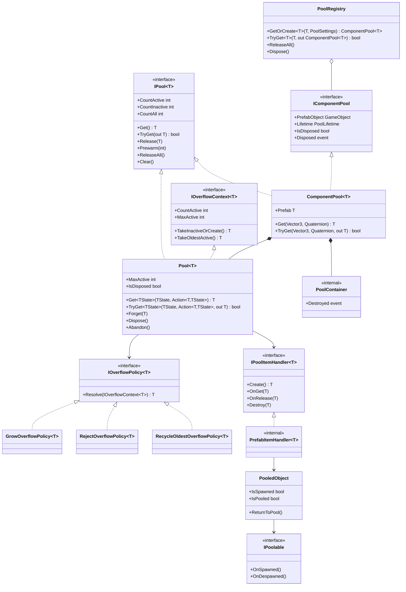
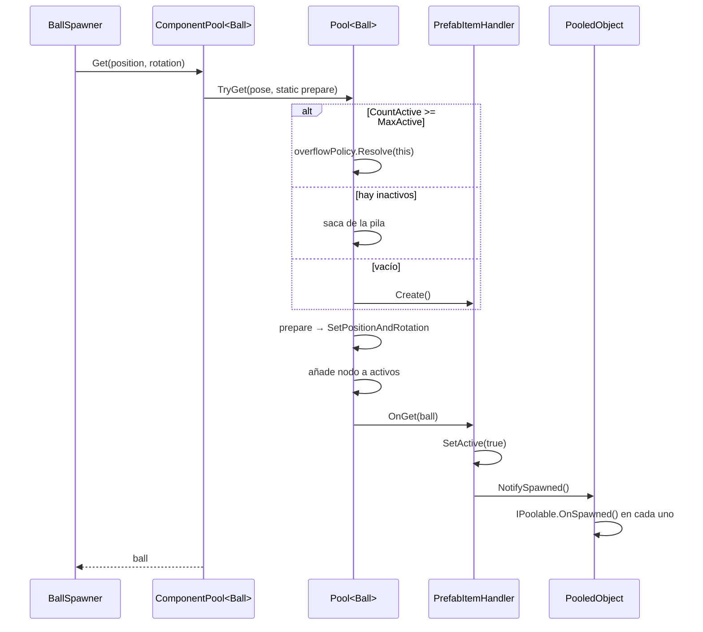
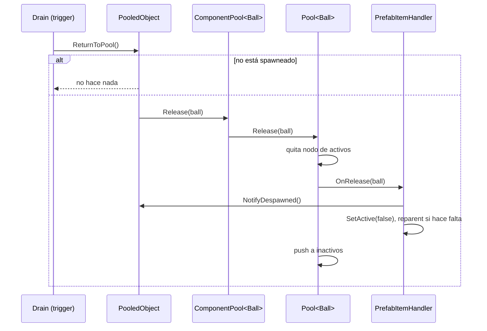

# com.miradorworks.pooling — Documento de diseño

> Versión del documento: 0.2 (3 nov 2026)
> Estado: diseño cerrado para v0.1.0
> Repositorio: `mw-objpooling`
> Ubicación en el repo: `Documentation~/DESIGN.md`

---

## 1. Contexto y objetivo

El equipo quiere construir una suite de herramientas reutilizables para Unity. La primera pieza es un **object pooler**, porque el proyecto de pinball que tienen en marcha genera muchas bolas y necesita reutilizarlas en lugar de instanciarlas y destruirlas continuamente.

**Objetivo de v0.1.0:** un paquete UPM, instalable por Git URL, que:

- Reutilice objetos sin generar basura para el GC después del prewarm.
- Sea independiente de cualquier juego concreto y de cualquier mecanismo de inyección de dependencias.
- Permita elegir, por pool, si sobrevive o no a los cambios de escena.
- Se valide en el pinball antes de darse por terminado.

### 1.1 Fuera de alcance (v0.1.0)

- Configuración de pools mediante ScriptableObjects (`PoolConfig`).
- Ventana de editor para depurar pools.
- Integración con Addressables.
- Extras para ParticleSystem / VFX Graph.
- Thread safety (todo el uso es desde el hilo principal de Unity).
Estos puntos van a v0.2 o posteriores (ver sección 9).

---

## 2. Registro de decisiones

| ID | Decisión | Motivo |
| ---- | ---------- | -------- |
| D1 | **Un repositorio por paquete.** Este repo contiene solo `com.miradorworks.pooling`. | Versionado, CI y changelog independientes por pieza de la suite. |
| D2 | Package id `com.miradorworks.pooling`, namespace `MiradorWorks.Pooling`. Nombre del repo: `mw-objpooling`. | Coherencia con la marca. Unity solo usa el `name` del `package.json`, así que el nombre del repo puede ser más corto sin afectar a la instalación. |
| D3 | **Implementación propia**, sin envolver `UnityEngine.Pool.ObjectPool<T>`. | Necesitamos seguir los objetos *activos* (políticas de desbordamiento, `ReleaseAll`, doble devolución). Unity solo sigue los inactivos; envolverlo duplicaría el seguimiento. |
| D4 | El **core es C# puro** (asmdef con `noEngineReferences: true`). | Testeable sin Unity, reutilizable para objetos que no son GameObjects y con dependencias explícitas. |
| D5 | El desbordamiento usa el patrón **Strategy** (`IOverflowPolicy<T>`). En el inspector se elige con un enum que se traduce a una política. | Añadir políticas no obliga a modificar el pool (OCP). El enum mantiene el inspector simple; las políticas propias se pasan por código. |
| D6 | **Cero allocations por spawn** tras el prewarm: los nodos de la lista de activos se reutilizan, y `Get` acepta un estado + lambda `static`. | El pinball genera muchas bolas; cada allocation acaba en un pico del GC. |
| D7 | **Sin singletons ni service locator.** `PoolRegistry` es una clase normal y su dueño lo decide cada proyecto (bootstrap, VContainer…). | Las dependencias se ven en las firmas y el paquete no impone un mecanismo de DI. |
| D8 | Ciclo de vida por pool: `PoolLifetime.Scene` o `PoolLifetime.Persistent`. | Requisito del equipo. |
| D9 | `PooledObject.ReturnToPool()` es **idempotente**. Si el objeto no viene de un pool, hace `Destroy`. | Una bola puede tocar dos triggers del drain en el mismo frame. El mismo prefab sirve con o sin pool. |
| D10 | Si alguien destruye un objeto del pool por fuera, el pool lo **olvida en silencio** (`Forget`). Al descargar la escena, el pool se **abandona** (`Abandon`). | Evita referencias muertas sin llenar la consola de avisos durante la descarga de escenas. |
| D11 | El reseteo de estado va en `IPoolable.OnSpawned/OnDespawned`, no en `OnEnable`/`Start`. | `Awake` y `Start` solo se ejecutan una vez por instancia; `OnEnable` no garantiza el orden respecto al posicionamiento. |
| D12 | Versión mínima de Unity: `6000.0`. El equipo usa 6.6. | No usamos APIs exclusivas de 6.6; `Rigidbody.linearVelocity` existe desde Unity 6. |
| D13 | Tests EditMode y PlayMode con Unity Test Framework; CI con **GameCI** en `packageMode`. | El core se prueba en EditMode. El ciclo de vida (`DontDestroyOnLoad`, descarga de escenas) solo se puede probar en PlayMode. |
| D14 | Flujo igual que forgekit: `main` / `develop` / `feature/*`, Conventional Commits, semver con release candidates (`v0.1.0-rc.1`). | Proceso ya conocido por el equipo. |

### 2.1 Consecuencia importante de D1

UPM **no permite dependencias Git dentro del `package.json`**: solo admite versiones de un registro. Hoy no es un problema, porque el pooler no depende de otras piezas de la suite. Cuando exista un paquete que dependa de otro (por ejemplo, de un futuro `core`), habrá que elegir entre:

- un registro con scope (OpenUPM o uno propio), o
- que cada proyecto instale manualmente las dependencias por Git URL.
Queda como decisión pendiente para el segundo paquete de la suite.

---

## 3. Arquitectura

### 3.1 Capas

```
┌─────────────────────────────────────────────────────┐
│ Extras (opcionales)                                 │
│ RigidbodyPoolable · Rigidbody2DPoolable ·           │
│ TrailPoolable · ReturnAfterTime                     │
├─────────────────────────────────────────────────────┤
│ Capa Unity  (MiradorWorks.Pooling)                  │
│ ComponentPool<T> · PrefabItemHandler<T> ·           │
│ PooledObject · IPoolable · PoolSettings ·           │
│ PoolLifetime · OverflowMode · PoolContainer ·       │
│ PoolRegistry                                        │
├─────────────────────────────────────────────────────┤
│ Core  (MiradorWorks.Pooling.Core, C# puro)          │
│ IPool<T> · Pool<T> · IPoolItemHandler<T> ·          │
│ IOverflowPolicy<T> · IOverflowContext<T> ·          │
│ Grow / Reject / RecycleOldest                       │
└─────────────────────────────────────────────────────┘
```

Las dependencias van siempre hacia abajo: los Extras usan la capa Unity, la capa Unity usa el Core y el Core no conoce a nadie.

### 3.2 Diagrama de clases



### 3.3 Estructura del paquete

```
mw-objpooling/                    (raíz del repo = raíz del paquete)
├── package.json
├── .gitignore
├── README.md                     (ES + EN)
├── CHANGELOG.md
├── LICENSE.md
├── Documentation~/
│   └── DESIGN.md                 (este documento)
├── Runtime/
│   ├── Core/
│   │   ├── MiradorWorks.Pooling.Core.asmdef   (noEngineReferences)
│   │   ├── IPool.cs
│   │   ├── IPoolItemHandler.cs
│   │   ├── IOverflowPolicy.cs
│   │   ├── IOverflowContext.cs
│   │   ├── Pool.cs
│   │   └── Policies/
│   │       ├── GrowOverflowPolicy.cs
│   │       ├── RejectOverflowPolicy.cs
│   │       └── RecycleOldestOverflowPolicy.cs
│   └── Unity/
│       ├── MiradorWorks.Pooling.asmdef        (→ Core)
│       ├── IPoolable.cs
│       ├── PooledObject.cs
│       ├── PoolSettings.cs
│       ├── PoolLifetime.cs
│       ├── OverflowMode.cs
│       ├── OverflowPolicyFactory.cs           (internal)
│       ├── PoolContainer.cs                   (internal)
│       ├── PrefabItemHandler.cs               (internal)
│       ├── IComponentPool.cs
│       ├── ComponentPool.cs
│       ├── PoolRegistry.cs
│       └── Extras/
│           ├── RigidbodyPoolable.cs
│           ├── Rigidbody2DPoolable.cs
│           ├── TrailPoolable.cs
│           └── ReturnAfterTime.cs
├── Tests/
│   ├── EditMode/
│   │   └── MiradorWorks.Pooling.Tests.EditMode.asmdef
│   └── PlayMode/
│       └── MiradorWorks.Pooling.Tests.PlayMode.asmdef
└── Samples~/
    └── BasicSpawner/
```

Las carpetas terminadas en `~` (`Documentation~`, `Samples~`) las ignora Unity al importar el paquete: no se compilan ni generan `.meta`.

---

## 4. Especificación del Core

### 4.1 `IPool<T> where T : class`

| Miembro | Comportamiento |
| --------- | ---------------- |
| `CountActive`, `CountInactive`, `CountAll` | Contadores. `CountAll = CountActive + CountInactive`. |
| `Get()` | Devuelve un objeto activo, o `null` si la política de desbordamiento rechaza la petición. |
| `TryGet(out T)` | Igual que `Get`, pero indica el éxito con un `bool`. |
| `Release(T)` | Devuelve el objeto al pool. **Lanza** `InvalidOperationException` si no está activo en este pool (doble devolución u objeto ajeno). |
| `Prewarm(int count)` | Crea objetos inactivos hasta que `CountAll >= count`. |
| `ReleaseAll()` | Devuelve todos los objetos activos. |
| `Clear()` | Destruye los objetos **inactivos**. Los activos no se tocan, porque los está usando alguien. |

### 4.2 `IPoolItemHandler<T>`

Sabe *qué* es el objeto; el pool solo sabe *cuándo* hay que llamar a cada método.

| Miembro | Contrato |
| --------- | ---------- |
| `Create()` | Crea un objeto nuevo. **Debe devolverlo ya en estado inactivo.** |
| `OnGet(T)` | Se llama al sacar el objeto, después de prepararlo. |
| `OnRelease(T)` | Se llama al devolver el objeto. |
| `Destroy(T)` | Destruye definitivamente el objeto. |

### 4.3 Desbordamiento

`MaxActive = 0` significa sin límite. Cuando `CountActive >= MaxActive`, el pool delega en la política:

| Política | Comportamiento |
| ---------- | ---------------- |
| `GrowOverflowPolicy` | Da un objeto de todas formas: el límite es orientativo. Es la política por defecto. |
| `RejectOverflowPolicy` | Devuelve `null`, así que `TryGet` devuelve `false`. |
| `RecycleOldestOverflowPolicy` | Devuelve el activo más antiguo (pasando por `OnRelease`) y lo reutiliza. |

`IOverflowContext<T>` expone solo lo que una política necesita. `Pool<T>` lo implementa de forma **explícita**, para que esos métodos no aparezcan en su API pública.

### 4.4 `Pool<T>`: detalles internos

- **Inactivos:** una `List<T>` usada como pila (sacar y meter por el final). Es O(1) y permite quitar un elemento concreto en `Forget`.
- **Activos:** una `LinkedList<T>` ordenada por antigüedad (necesaria para RecycleOldest), más un `Dictionary<T, LinkedListNode<T>>` con el nodo de *cada* objeto. El nodo se crea la primera vez que el objeto se activa y se reutiliza siempre después. Para saber si un objeto está activo se comprueba `node.List == _active`.
- **`Get<TState>(state, prepare)`:** `prepare` se ejecuta *antes* de `OnGet`. Con una lambda `static` y un `TState` de tipo struct no se crea ninguna closure.
- **`Forget(T)`:** deja de seguir el objeto sin llamar al handler. Si el objeto no está en el pool, no hace nada.
- **`Dispose()`:** destruye todos los objetos (activos e inactivos) mediante el handler. Las llamadas posteriores a `Get` lanzan `ObjectDisposedException`, y `Release` destruye el objeto en lugar de guardarlo.
- **`Abandon()`:** deja de seguir todos los objetos sin destruirlos. Se usa cuando el motor ya los ha destruido.

---

## 5. Especificación de la capa Unity

### 5.1 `ComponentPool<T> where T : Component`

- Recibe el prefab como `T` (por ejemplo `Ball`), de modo que `Get` devuelve `Ball` sin necesidad de `GetComponent`.
- Constructor: `(T prefab, PoolSettings settings, IOverflowPolicy<T> overflowPolicy = null, Transform parent = null)`.
- `Get(position, rotation)` posiciona el objeto **antes** de `SetActive(true)`, usando `Pose` como `TState`.
- Implementa `IPool<T>` e `IComponentPool`. Esta última es una interfaz no genérica que usa el registro.
- Evento `Disposed`: se lanza al hacer `Dispose()` o cuando el contenedor se destruye con la escena.

### 5.2 `PrefabItemHandler<T>` (interno)

- `Create`: instancia el prefab bajo el contenedor, le pone un nombre numerado, lo desactiva, añade `PooledObject` (o reutiliza el que ya tenga) y lo vincula al pool.
- `OnGet`: `SetActive(true)` y después `PooledObject.NotifySpawned()`.
- `OnRelease`: `NotifyDespawned()`, después `SetActive(false)`, y lo vuelve a colgar del contenedor si alguien lo había movido.
- `Destroy`: `Object.Destroy(gameObject)` comprobando antes que no sea null.
- Guarda un diccionario objeto → `PooledObject` para no llamar a `GetComponent` en cada spawn.

### 5.3 `PooledObject` y `IPoolable`

- `PooledObject` se añade automáticamente a cada instancia. Al vincularse, cachea con `GetComponentsInChildren<IPoolable>(true)` todos los `IPoolable` del objeto y sus hijos.
- `ReturnToPool()`:
  - Si no viene de un pool → `Destroy(gameObject)`.
  - Si ya está devuelto → no hace nada (D9).
- `OnDestroy` avisa al pool para que lo olvide (D10).

### 5.4 `PoolSettings`

Struct serializable, editable desde el inspector del spawner:

| Campo | Tipo | Por defecto |
| ------- | ------ | ------------- |
| `InitialSize` | `int` (≥ 0) | 10 |
| `MaxActive` | `int` (≥ 0, 0 = sin límite) | 0 |
| `OverflowMode` | `Grow` / `Reject` / `RecycleOldest` | `Grow` |
| `Lifetime` | `Scene` / `Persistent` | `Scene` |

### 5.5 Ciclo de vida (D8)

`PoolContainer` es un GameObject raíz llamado `[Pool] <prefab>` que avisa cuando se destruye. Los objetos del pool son siempre hijos suyos.

| | `Scene` | `Persistent` |
| --- | --------- | -------------- |
| Dónde vive el contenedor | Escena activa, o bajo el `parent` indicado | `DontDestroyOnLoad` (si se pasa `parent`, se ignora y se muestra un aviso) |
| Al descargar la escena | Unity destruye contenedor y objetos; el pool hace `Abandon()` y lanza `Disposed` | Sobrevive |
| Objetos activos al cambiar de escena | Se destruyen con la escena | **Siguen activos**: el juego debe llamar a `ReleaseAll()` |
| Quién debería ser su dueño | El spawner de la escena | Algo que sobreviva a la escena: `PoolRegistry` |

**Limitación conocida:** un pool `Scene` creado sin `parent` coloca el contenedor en la escena *activa*. Si se crea desde una escena cargada de forma aditiva, hay que pasar un `parent` de esa escena.

### 5.6 `PoolRegistry` (D7)

- Clase normal que implementa `IDisposable`. Guarda los pools indexados por el `GameObject` del prefab.
- `GetOrCreate<T>(prefab, settings, policy = null)`: si el pool ya existe, lo devuelve e **ignora** los `settings` nuevos (queda documentado).
- `TryGet<T>`: lanza una excepción si el prefab ya está en un pool con otro tipo de componente.
- Se suscribe a `Disposed` de cada pool y lo elimina automáticamente.
- `ReleaseAll()` y `Dispose()` actúan sobre todos los pools.

### 5.7 Extras

| Componente | Requiere | Qué hace |
| ------------ | ---------- | ---------- |
| `RigidbodyPoolable` | `Rigidbody` | En `OnSpawned` pone a cero `linearVelocity` y `angularVelocity` (salvo si es kinematic). |
| `Rigidbody2DPoolable` | `Rigidbody2D` | Igual en 2D (salvo si es `Static`). |
| `TrailPoolable` | `TrailRenderer` | `Clear()` en `OnSpawned`. |
| `ReturnAfterTime` | `PooledObject` | Devuelve el objeto tras N segundos, con opción de tiempo sin escalar. |

El reseteo de las físicas se hace en `OnSpawned` y no en `OnDespawned`, porque al reactivar el objeto el Rigidbody ya existe en el motor de físicas.

---

## 6. Flujos

### 6.1 Spawn



### 6.2 Release



---

## 7. Reglas de uso para el equipo

1. Quien saca un objeto del pool es responsable de devolverlo con `ReturnToPool()`. **Nunca `Destroy`.**
2. La lógica de "empezar de cero" va en `IPoolable.OnSpawned`, no en `Awake`, `Start` ni `OnEnable`.
3. Para aplicar una velocidad inicial, hazlo *después* de `Get`, cuando `RigidbodyPoolable` ya la ha puesto a cero.
4. Con pools `Persistent`, llama a `ReleaseAll()` antes o durante el cambio de escena.
5. No guardes referencias a un objeto después de devolverlo: el siguiente `Get` puede entregárselo a otro.

---

## 8. Hoja de ruta y tareas

Cada tarea es una rama `feature/*` que sale de `develop`, se integra con su PR y tiene un commit con formato Conventional Commits. Las tareas que tocan código incluyen sus tests.

### Hito 0 — Repo e infraestructura

| ID | Tarea | Hecho cuando… |
| ---- | ------- | --------------- |
| T0.1 | Crear el repo `mw-objpooling`, ramas `main` y `develop`, `.gitignore`, `LICENSE.md` (si es público) y este documento en `Documentation~/`. | Repo en GitHub con ambas ramas y el diseño subido. |
| T0.2 | Esqueleto del paquete: `package.json`, carpetas, asmdefs (Core, Unity, Tests), `README.md` (ES + EN), `CHANGELOG.md`. | El paquete se importa sin errores en un proyecto vacío. |
| T0.3 | Proyecto sandbox local (fuera del repo) que referencia el paquete con `file:` en su `manifest.json` y lo marca en `testables`. | Los tests (vacíos) aparecen en el Test Runner. |
| T0.4 | CI con GameCI (`unity-test-runner` en `packageMode`) para EditMode y PlayMode, con la licencia guardada como secret. | La Action pasa en verde en un PR a `develop`. |

### Hito 1 — Core

| ID | Tarea | Hecho cuando… |
| ---- | ------- | --------------- |
| T1.1 | Interfaces: `IPool<T>`, `IPoolItemHandler<T>`, `IOverflowPolicy<T>`, `IOverflowContext<T>`. | Compila con `noEngineReferences`. |
| T1.2 | `Pool<T>` básico: `Get`, `TryGet`, `Release`, `Prewarm`, contadores, pila de inactivos y seguimiento de activos con nodos reutilizados. | Tests: get/release, prewarm, contadores, doble release lanza excepción. |
| T1.3 | Las tres políticas de desbordamiento e integración con `MaxActive`. | Tests de cada política. |
| T1.4 | `Get<TState>` con `prepare`, `ReleaseAll`, `Clear`, `Forget`, `Dispose`, `Abandon`. | Tests de orden (prepare antes de OnGet) y de los estados tras dispose. |

Los tests del Core usan un `FakeItemHandler` que registra las llamadas, así que no necesitan GameObjects.

### Hito 2 — Capa Unity

| ID | Tarea | Hecho cuando… |
| ---- | ------- | --------------- |
| T2.1 | `IPoolable`, `PooledObject`. | Tests EditMode: idempotencia, fallback a `Destroy`, callbacks. |
| T2.2 | `PoolSettings`, `PoolLifetime`, `OverflowMode`, `OverflowPolicyFactory`. | El struct se ve y se edita correctamente en el inspector. |
| T2.3 | `PoolContainer` y `PrefabItemHandler<T>`. | Tests: creación inactiva, reparent al devolver, no hay `GetComponent` por spawn. |
| T2.4 | `IComponentPool` y `ComponentPool<T>`, con `Get(position, rotation)`. | Tests: posición aplicada antes de activar, evento `Disposed`. |
| T2.5 | Ciclo de vida Scene / Persistent. | Tests PlayMode: descarga de escena → `Abandon`; persistent sobrevive. |
| T2.6 | `PoolRegistry`. | Tests: reutiliza el pool, error con tipo distinto, eliminación al hacer dispose. |

### Hito 3 — Extras y muestra

| ID | Tarea | Hecho cuando… |
| ---- | ------- | --------------- |
| T3.1 | `RigidbodyPoolable`, `Rigidbody2DPoolable`, `TrailPoolable`. | Tests PlayMode de reseteo. |
| T3.2 | `ReturnAfterTime`. | Test PlayMode de devolución tras el tiempo indicado. |
| T3.3 | Muestra `Samples~/BasicSpawner` declarada en `package.json`. | Se importa desde el Package Manager y funciona. |

### Hito 4 — Validación y release

| ID | Tarea | Hecho cuando… |
| ---- | ------- | --------------- |
| T4.1 | Release `v0.1.0-rc.1` (merge a `main`, tag, entrada en el CHANGELOG). | El tag se instala por Git URL `…#v0.1.0-rc.1`. |
| T4.2 | Integración en el pinball. | Las bolas usan el pool. El Profiler muestra **0 B de GC Alloc** por spawn tras el prewarm. |
| T4.3 | Correcciones a partir del feedback del equipo (`rc.2`… si hace falta). | Sin incidencias abiertas que bloqueen la versión. |
| T4.4 | Release `v0.1.0`. | Tag estable y README actualizado. |

---

## 9. Futuro (v0.2+)

- `PoolConfig` (ScriptableObject) y un bootstrapper que cree pools a partir de assets.
- Ventana de editor con los pools vivos y sus contadores.
- `ParticlesPoolable` / `ReturnOnParticlesFinished`.
- Decidir registro con scope (OpenUPM o propio) cuando exista un segundo paquete con dependencias (ver 2.1).
- Valorar soporte para Addressables.

---

## 10. Glosario

| Término | Significado |
| --------- | ------------- |
| **UPM** | Unity Package Manager. Gestiona paquetes definidos por un `package.json`. |
| **Git URL** | Forma de instalar un paquete UPM directamente desde un repo: `https://github.com/<owner>/mw-objpooling.git#v0.1.0`. |
| **asmdef** | Assembly Definition. Separa el código en ensamblados: compila más rápido y obliga a declarar las dependencias. |
| **`noEngineReferences`** | Opción del asmdef que impide referenciar `UnityEngine`. Garantiza que el Core es C# puro. |
| **testables** | Lista del `manifest.json` de un proyecto que indica a Unity qué paquetes deben mostrar sus tests en el Test Runner. |
| **GameCI** | Conjunto de GitHub Actions que ejecutan Unity en CI (tests y builds). Necesita una licencia de Unity guardada como secret. |
| **Prewarm** | Crear objetos por adelantado (por ejemplo, en una pantalla de carga) para no instanciarlos durante la partida. |
| **Closure** | Objeto que C# crea cuando una lambda captura variables externas. Genera allocation; una lambda `static` lo impide. |

---

## 11. Changelog del documento

| Versión | Fecha | Cambios |
|---------|-------|---------|
| 0.1 | 2026-11-01 | Primera versión: decisiones D1–D14, arquitectura, especificación y hoja de ruta de v0.1.0. |
| 0.2 | 2026-11-03 | Repo renombrado a `mw-objpooling` (D2, 3.3, glosario). El documento se sube en T0.1. |
